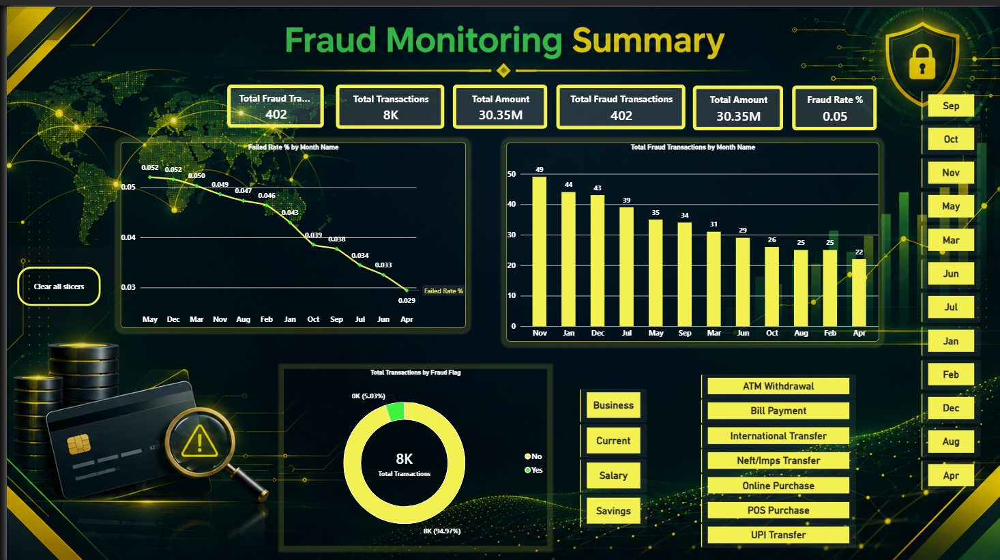
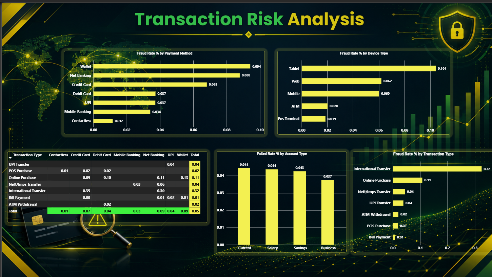
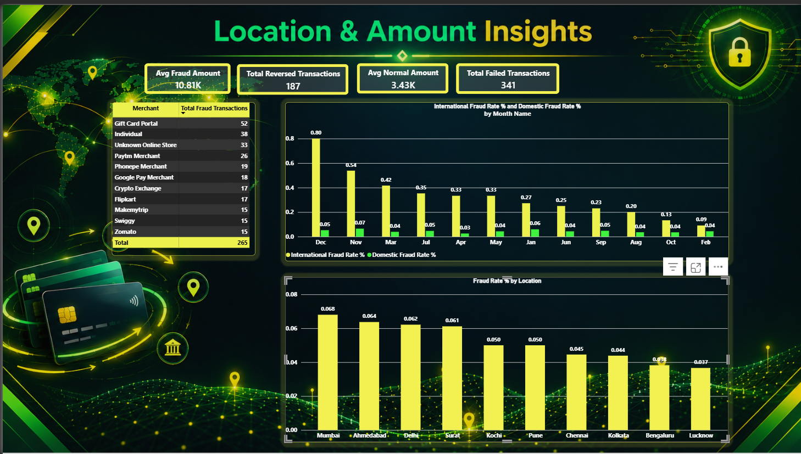
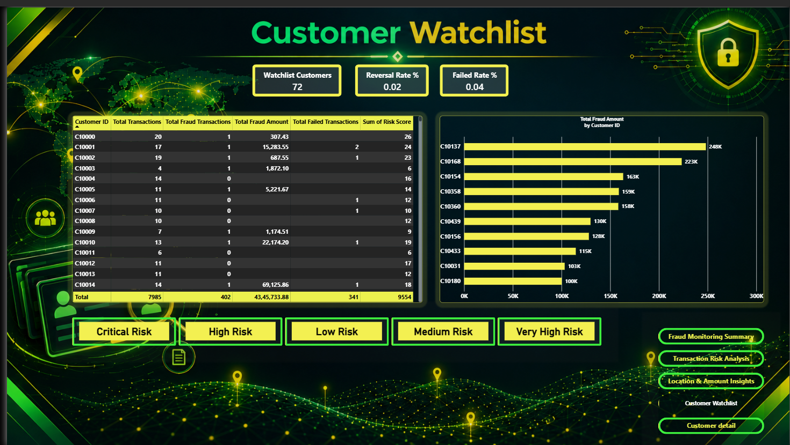

# Financial Analytics, Fraud Detection & Transaction Risk Analysis

## Project Overview

This project is an interactive Power BI dashboard designed to
analyze financial transactions, monitor fraudulent activity,
and identify potential transaction risks.

The dashboard presents insights into fraud rates, transaction
patterns, payment methods, device types, account categories,
merchants, geographical locations, and high-risk customers.

It demonstrates the application of data visualization and
business intelligence techniques to financial fraud analysis.

## Objectives

- Monitor key financial and fraud-related performance indicators.
- Analyze fraud trends across months.
- Compare fraud rates across payment methods and device types.
- Examine transaction risks by account and transaction type.
- Identify merchants with higher numbers of flagged transactions.
- Compare fraud activity across geographical locations.
- Identify high-risk customers using customer-level risk scores and fraud amounts.
- Present findings through an interactive Power BI dashboard.

## Tools & Technologies

- Microsoft Power BI
- Power Query
- DAX (Data Analysis Expressions)
- Data Visualization
- Financial Transaction Analysis

## Dashboard Pages

### 1. Fraud Monitoring Summary

Provides an overview of fraud monitoring metrics, including:

- Total Transactions
- Total Fraud Transactions
- Total Transaction Amount
- Fraud Rate
- Monthly Fraud Trends
- Fraud Flags Distribution

### 2. Transaction Risk Analysis

Analyzes transaction risk across different categories:

- Fraud Rate by Payment Method
- Fraud Rate by Device Type
- Failed Rate by Account Type
- Fraud Rate by Transaction Type
- Transaction Type and Payment Method Analysis

### 3. Location & Amount Insights

Focuses on geographical and merchant-level fraud analysis:

- Average Fraud Amount
- Reversed Transactions
- Failed Transactions
- Merchant-Level Fraud Analysis
- Domestic and International Fraud Trends
- Fraud Rate by Location

### 4. Customer Watchlist

Identifies and monitors customers flagged for risk, including:

- Watchlist Customers
- Reversal Rate %
- Failed Rate %
- Customer-Level Transactions, Fraud Transactions, Fraud Amount and Failed Transactions
- Risk Score by Customer
- Total Fraud Amount by Customer ID
- Risk Level Filters: Low, Medium, High, Very High and Critical

## Key Business Questions

- How does the fraud rate change over time?
- Which payment methods have higher observed fraud rates?
- Which device types are associated with higher fraud rates?
- Which transaction types account for more flagged transactions?
- Which merchants have the highest numbers of fraud-related transactions?
- How do fraud rates vary across locations?
- Which customers are on the watchlist, and what are their risk levels?
- Which customers account for the highest total fraud amounts?

## Key Skills Demonstrated

- Dashboard Design
- Data Analysis
- KPI Development
- DAX Measures
- Interactive Data Visualization
- Fraud and Transaction Risk Analysis
- Customer Risk Scoring and Watchlist Monitoring
- Business Intelligence Reporting

## Dataset

The project uses financial transaction data for fraud and
transaction risk analysis.

Dataset details, source, and licensing information should be
documented here when available.

## How to Explore the Project

1. Review the dashboard screenshots in the Screenshots folder.
2. Open the Power BI report from the Dashboard folder.
3. Review the report pages and interact with the available
   filters and slicers.
4. Examine the dataset and calculations if the corresponding
   files are included.

## Disclaimer

This project is intended for educational and portfolio purposes.

The dashboard highlights patterns in the available dataset.
Observed relationships do not necessarily establish the causes
of fraudulent activity.

## Author

**Trisham Gautam**
